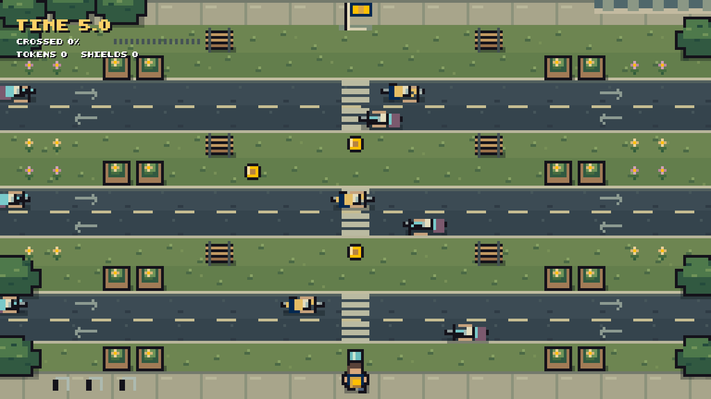
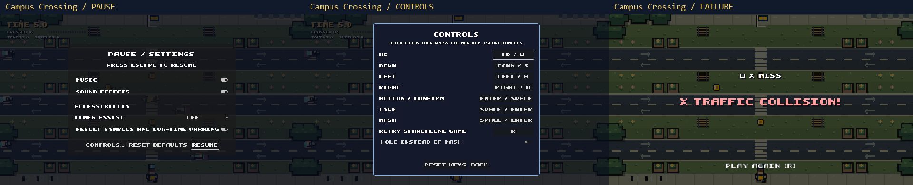
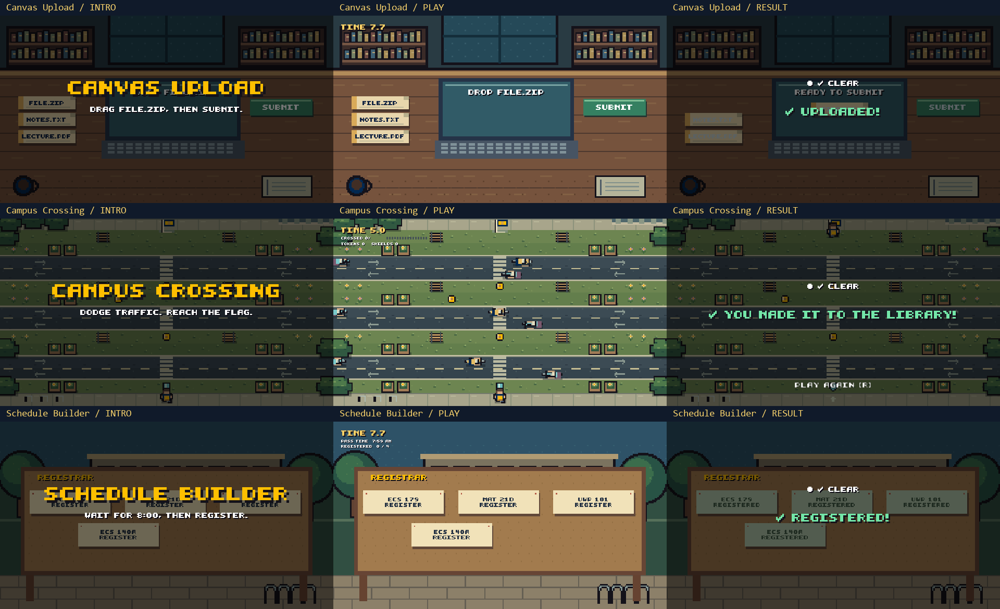
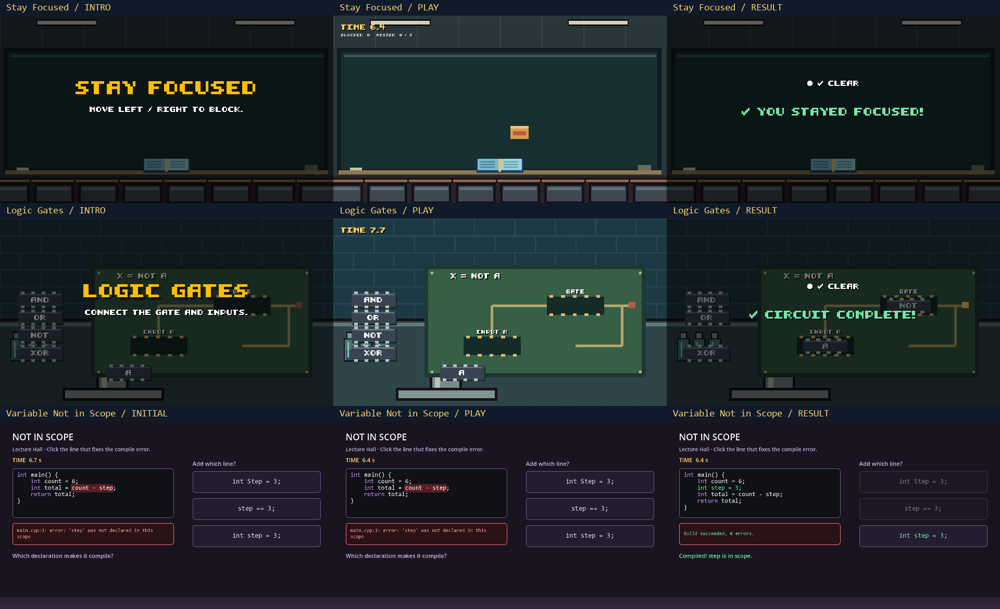
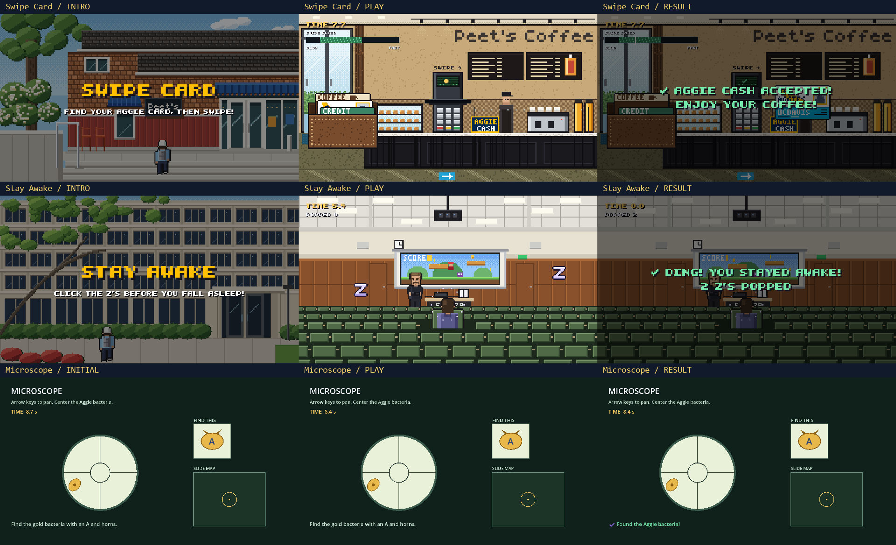
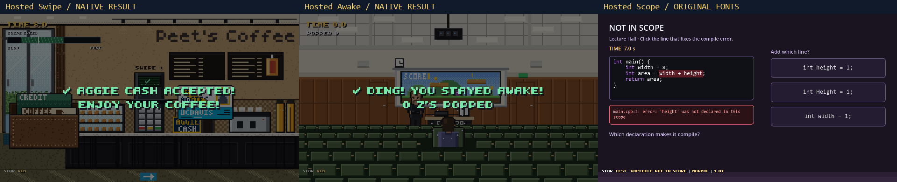

# Format v1.0 review captures

Captured from Godot 4.7.2 at 1280 x 720 after the PR #15 review changes. The galleries show intro (or initial gameplay), play, and successful result from left to right. Scope and Microscope retain their original immediate-start behavior. Gallery thumbnails use nearest-neighbor reduction; the full-size Crossing capture preserves the native 5x pixel grid.

## Campus Crossing

The playable world fills the viewport. Roads, bicycles, scooters, the student, obstacles, pickups, and campus scenery use the same pixel scale. The overlay provides TIME, crossing progress, and token/shield counts. The boxed location signs and gameplay pause hint have been removed. Escape still opens the pause menu, and independent play includes a retry button after completion.

## All nine games

## Preserved native games inside the launcher

Swipe Card and Stay Awake display only their original result messages; the host adds no second banner. Scope keeps its original interface and case-sensitive fonts even inside the pixel-themed launcher. The four native implementations, their assets, and their shared presentation helpers match PR #16 exactly.

Run `tools/capture_collection.gd` with a graphics renderer to regenerate all 36 source captures under `artifacts/collection-preview/`. Headless regression tests and recorded build results are described in [VALIDATION.md](../../VALIDATION.md).
